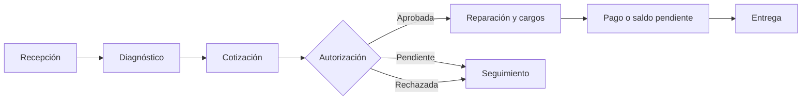
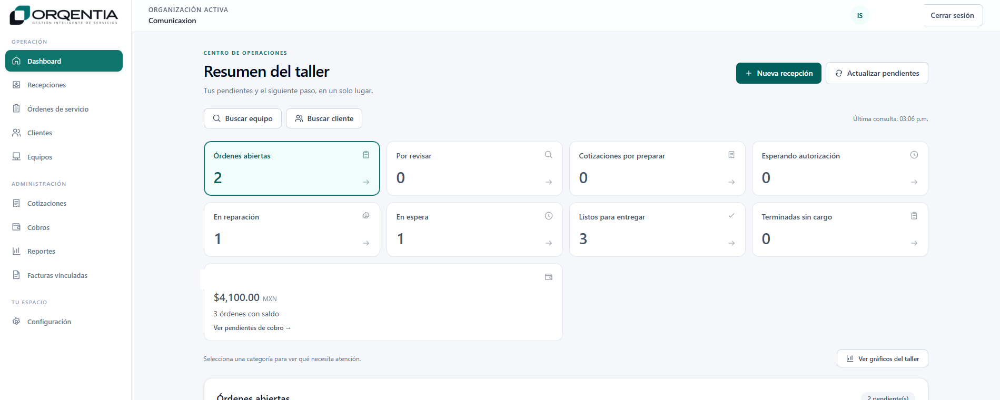
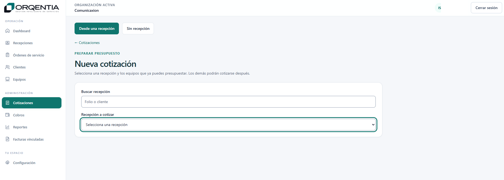

  

  
  
  
  

# Orqentia — Gestión de servicios técnicos

**Producto propio de ComunicAxion · Desarrollo full-stack · Automatización de procesos operativos**

Estoy desarrollando **Orqentia** para organizar la operación de talleres de servicio técnico. La idea surgió de una necesidad concreta: **poder seguir cada equipo, trabajo y movimiento administrativo desde su recepción hasta su entrega** sin depender de notas dispersas, mensajes o registros separados.

El producto está en **desarrollo incremental**. He trabajado en su estructura de datos, API, interfaz y módulos de seguimiento, con una arquitectura que permite evolucionar el sistema a medida que validamos las necesidades del taller.

## El problema que quiero resolver

En un taller, una reparación puede pasar por recepción, revisión, diagnóstico, cotización, autorización, reparación, cargos, pagos y entrega.

Cuando cada etapa se gestiona por separado es fácil perder visibilidad: equipos terminados que no se han cobrado, autorizaciones pendientes, reparaciones en espera o trabajos listos para entregar.

Con Orqentia busco **centralizar esa operación**, dar claridad al estado de cada servicio y facilitar el seguimiento diario.

## El flujo de trabajo

El producto está diseñado alrededor del ciclo de atención completo:

*Este es el flujo de negocio que guía el desarrollo; sus componentes se incorporan y validan por incrementos.*

## Componentes del prototipo

| Componente | Trabajo realizado |
| --- | --- |
| **Organizaciones y seguridad** | Estructura para gestionar el acceso y separar los contextos de operación. |
| **Clientes y contactos** | Modelo para relacionar personas y empresas con los servicios. |
| **Activos** | Identificación de equipos y dispositivos recibidos para atención. |
| **Recepciones** | Registro del ingreso de equipos y seguimiento de información asociada. |
| **Operación del taller** | Desarrollo progresivo de estados y acciones de diagnóstico, reparación, cotización y entrega. |
| **Dashboard** | Vistas de seguimiento, incluyendo el caso de trabajos terminados que todavía no tienen cargo. |
| **Administración del servicio** | Diseño del seguimiento de autorizaciones, cargos y pagos pendientes. |

## Orqentia en imágenes

Las siguientes pantallas corresponden a **capturas del prototipo**, con información privada retirada para su presentación pública.

### Centro de operaciones

El dashboard permite visualizar las diferentes etapas del trabajo técnico y reunir indicadores operativos y administrativos en una misma interfaz.

### Preparación de cotizaciones

Interfaz de preparación de cotizaciones con opciones para partir de una recepción o trabajar con un registro independiente.

## Arquitectura y tecnologías

Diseñé el prototipo separando la **interfaz, los servicios de la API y la persistencia de datos**, para poder desarrollar y probar cada componente de manera independiente.

| Capa | Tecnología |
| --- | --- |
| **Frontend** | React · TypeScript · Vite · Tailwind CSS |
| **Backend** | Python · FastAPI |
| **Modelo de datos** | SQLAlchemy |
| **Migraciones** | Alembic |
| **Base de datos local** | SQLite |
| **Desarrollo y calidad** | Git · pruebas automatizadas de frontend y backend |

Como referencia del avance alcanzado, el desarrollo registró **85 pruebas de backend y 29 de frontend aprobadas**, así como migraciones de base de datos de la **0001 a la 0005**. Son resultados de una etapa del prototipo, no cifras de una ejecución realizada hoy.

[Conocer las decisiones de arquitectura](docs/arquitectura.md).

## Decisiones de producto

He tomado algunas decisiones para orientar el desarrollo:

1. **Seguir equipos, no solo órdenes:** el sistema debe conservar el historial de atención de cada activo.
2. **Separar correctamente la información:** clientes, contactos, activos y recepciones no representan lo mismo.
3. **Dar visibilidad a los pendientes:** quiero identificar trabajos terminados sin cargo, saldos pendientes y equipos listos para entregar.
4. **Construir por incrementos:** prefiero incorporar funciones pequeñas, con pruebas y migraciones controladas.
5. **Preparar el crecimiento:** la solución nace para una operación local, pero su arquitectura debe permitir evaluar otros escenarios de uso.

## Hacia dónde quiero llevarlo

Mi siguiente objetivo es **consolidar los recorridos completos del taller y probarlos en la operación diaria**. Después evaluaré necesidades de configuración, respaldo, reportes y posibles formas de distribución.

También estudio, por separado, la arquitectura de un **ERP modular**. Una futura relación entre ambas iniciativas es una posibilidad de diseño, no una integración ya realizada.

[Consultar la hoja de ruta](docs/roadmap.md).

## Sobre este repositorio

Aquí comparto el diseño del producto, su arquitectura y algunas pantallas de desarrollo. El código fuente y los datos operativos se mantienen en repositorios de trabajo privados.

[Política de privacidad y publicación](docs/privacidad.md).

---

<strong>Software pensado para organizar el trabajo real de un taller.</strong>

<a href="https://github.com/isaiassolis">Isaías Solís · Portafolio profesional</a>

