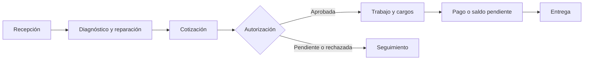

  

  
  
  
  

  
  

# ComunicAxion Service Manager

> **Software empresarial · Desarrollo full-stack · Caso de estudio de producto.**

**ComunicAxion Service Manager** es un sistema en desarrollo para organizar el ciclo de atención de un taller de servicio técnico: desde la recepción de un equipo hasta el diagnóstico, la cotización, la autorización, el cobro y la entrega.

**Alcance de este repositorio:** documentación pública del proyecto y su arquitectura. **No contiene código fuente, información de clientes ni datos operativos del taller.**

## El problema

Un taller puede llevar el seguimiento de equipos mediante notas, mensajes y hojas de cálculo independientes. Esto dificulta conocer qué se recibió, qué trabajo está pendiente, qué reparaciones se terminaron, qué pagos faltan y qué equipos están listos para entregar.

El objetivo del producto es ofrecer un flujo trazable, con estados claros y una interfaz que reduzca las consultas manuales.

## Flujo de negocio

> Este diagrama describe el **flujo de negocio objetivo**; no implica que todas las transiciones o automatizaciones estén terminadas en la versión actual.

## Componentes trabajados en el prototipo

| Área | Trabajo documentado |
| --- | --- |
| Organizaciones y seguridad | Estructura de acceso y separación organizacional |
| Clientes y contactos | Registro y relación con servicios |
| Activos | Identificación de equipos atendidos |
| Recepciones | Registro y seguimiento del ingreso |
| Flujo operativo | Estados de reparación, cotización y entrega en desarrollo incremental |
| Dashboard | Vista de seguimiento, incluido el caso de trabajos terminados sin cargo |
| Cobros | Necesidad funcional de identificar cargos y pagos pendientes |

Las áreas de la tabla **no equivalen a una certificación de que cada flujo está completo o desplegado en producción**. Las capacidades se han desarrollado por incrementos y deben validarse contra el estado actual del repositorio privado antes de una demostración.

## Arquitectura técnica del prototipo

| Capa | Tecnologías |
| --- | --- |
| Interfaz | **React, TypeScript, Vite, Tailwind CSS** |
| API | **Python, FastAPI** |
| Modelo de datos | **SQLAlchemy** |
| Migraciones | **Alembic** |
| Base de datos local | **SQLite** |
| Calidad | Pruebas automatizadas de frontend y backend |
| Control de versiones | Git |

El diseño separa presentación, API, lógica de negocio y persistencia para facilitar cambios y pruebas.

**Último registro técnico disponible:** hasta **85 pruebas de backend** y **29 de frontend** aprobadas, con migraciones `0001` a `0005`. Son resultados históricos del desarrollo, **no una ejecución reciente ni una auditoría independiente**.

[Leer decisiones de arquitectura](docs/arquitectura.md).

## Evidencia visual

Las capturas del sistema se incorporarán aquí cuando se revisen para excluir datos personales, nombres de clientes, teléfonos, números de serie y otros identificadores. **No se utilizan imágenes generadas para simular pantallas funcionales.**

[Consultar guía de capturas](screenshots/README.md).

## Decisiones de producto e ingeniería

1. **Flujo centrado en la operación:** cada equipo debe poder seguirse desde su ingreso hasta su entrega.
2. **Separación de entidades:** clientes, contactos, activos y recepciones tienen responsabilidades distintas.
3. **Visibilidad de excepciones:** trabajos terminados sin cargo y saldos pendientes merecen seguimiento específico.
4. **Desarrollo incremental:** incorporar módulos por etapas, con migraciones y pruebas.
5. **Privacidad:** la presentación pública excluye código y datos reales del negocio.

## Evolución prevista

El sistema puede evolucionar como producto independiente o, después de una evaluación arquitectónica, integrarse con un futuro **mini ERP modular**. **Esa integración no está implementada ni decidida.** Tampoco se presenta NestJS o PostgreSQL como parte del stack actual.

[Consultar hoja de ruta](docs/roadmap.md).

## Competencias que ilustra

- Análisis y modelado de procesos empresariales.
- Desarrollo full-stack con React/TypeScript y FastAPI.
- Diseño de entidades y persistencia relacional.
- Migraciones, pruebas y evolución incremental.
- Diseño de tableros y experiencia operativa.
- Delimitación del alcance entre prototipo, producto y plataforma futura.

## Privacidad y uso

Este repositorio es un **showcase documental**, no una distribución del software. No incluye credenciales, bases de datos, código privado, registros de clientes ni una licencia de explotación sobre componentes no publicados.

[Política de publicación y privacidad](docs/privacidad.md).

---

**Autor:** [Isaías Solís](https://github.com/isaiassolis) · [Portafolio en GitHub](https://github.com/isaiassolis)
