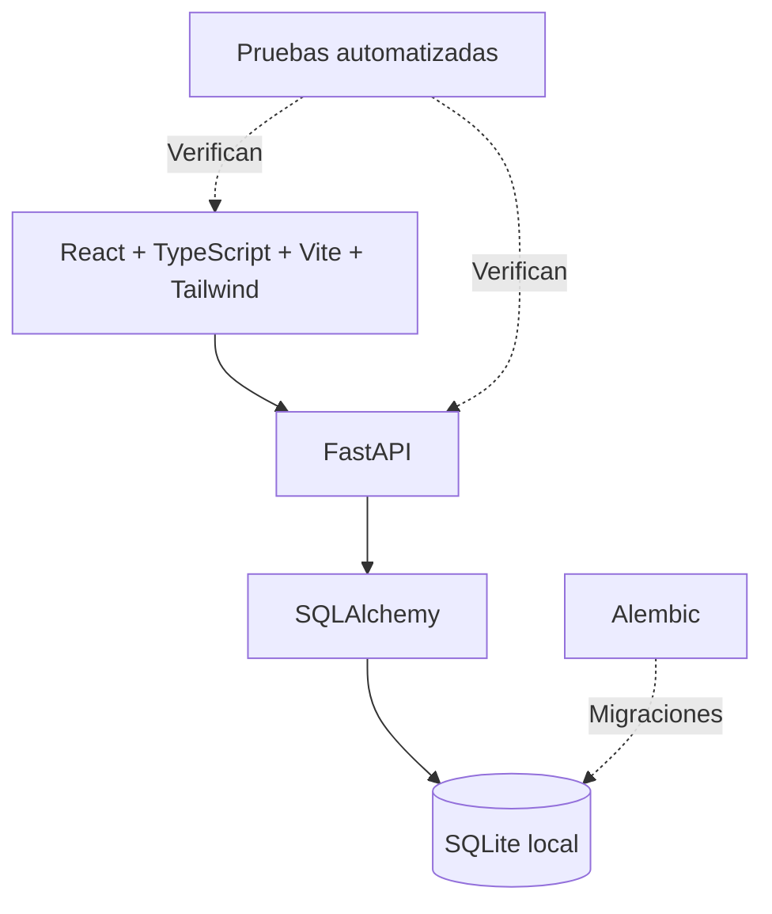

# Arquitectura — ComunicAxion Service Manager

## Estado y límites

Este documento describe la arquitectura conocida del prototipo. No equivale a una auditoría del código actual ni certifica disponibilidad en producción.

## Capas

## Modelo conceptual

- **Organización:** contexto de operación y acceso.
- **Cliente / contacto:** persona o entidad relacionada con un servicio.
- **Activo:** equipo o dispositivo atendido.
- **Recepción:** ingreso de un activo para atención.
- **Servicio:** trabajo técnico y seguimiento de estado.
- **Cotización / autorización:** condiciones y decisión del cliente.
- **Cargo / pago / entrega:** cierre administrativo y operativo.

Este es un **modelo conceptual**; no asegura correspondencia uno a uno con las tablas o endpoints existentes.

## Principios

1. Distinguir entidades de negocio de las pantallas que las presentan.
2. Evolucionar la base de datos mediante migraciones controladas.
3. Evitar que una recepción desaparezca del seguimiento antes de la entrega.
4. Identificar explícitamente casos excepcionales como «terminado sin cargo».
5. Conservar trazabilidad y pruebas al introducir nuevos estados.

## Stack confirmado históricamente

React, TypeScript, Vite, Tailwind CSS, FastAPI, SQLAlchemy, Alembic y SQLite. La propuesta de mini ERP basada en tecnologías distintas pertenece a **otro esfuerzo de diseño**, no a esta implementación.

## Evidencia y verificación pendiente

El registro histórico señala hasta 85 pruebas backend, 29 frontend y migraciones `0001`–`0005`. Antes de presentar métricas actuales, es necesario ejecutar las pruebas sobre el último estado privado.
