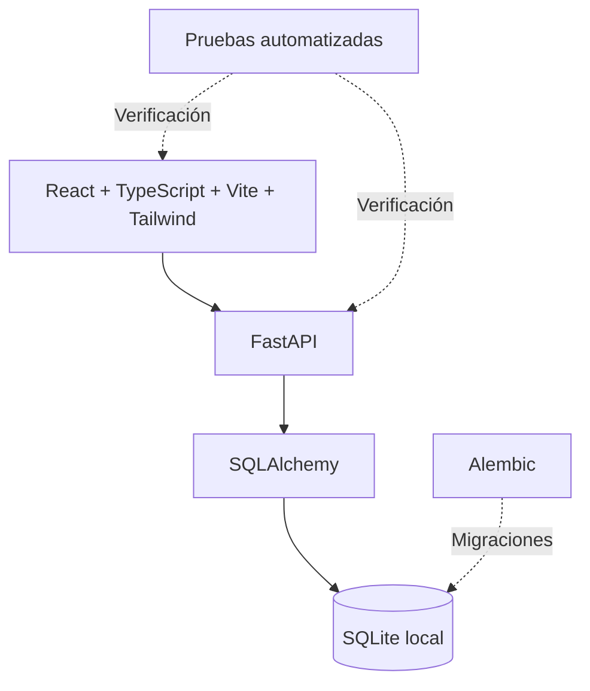

# Orqentia — Arquitectura del prototipo

## Objetivo técnico

Estoy construyendo Orqentia como un sistema modular para gestionar la operación de talleres de servicio técnico. Su arquitectura separa la interfaz de usuario, la API y la persistencia para facilitar el desarrollo, las pruebas y la evolución de los procesos.

## Componentes

## Modelo de negocio

El trabajo se organiza alrededor de entidades con responsabilidades diferentes:

| Entidad | Propósito |
| --- | --- |
| **Organización** | Contexto del taller y control de acceso. |
| **Cliente y contacto** | Personas y entidades relacionadas con la atención. |
| **Activo** | Equipo o dispositivo que ingresa para servicio. |
| **Recepción** | Registro del ingreso y de las condiciones de atención. |
| **Servicio** | Trabajo técnico y seguimiento operativo. |
| **Cotización y autorización** | Propuesta de trabajo y decisión del cliente. |
| **Cargo, pago y entrega** | Cierre administrativo y operativo del servicio. |

Este modelo expresa la organización funcional del producto. Los flujos se han incorporado progresivamente durante el desarrollo.

## Principios de ingeniería

- **Trazabilidad:** mantener visible el estado de un equipo durante todo su proceso de atención.
- **Separación de información:** evitar mezclar clientes, equipos, recepciones y movimientos administrativos.
- **Control de excepciones:** identificar trabajos terminados sin cargo y otros pendientes relevantes.
- **Evolución controlada:** introducir cambios de base de datos mediante Alembic y acompañarlos de pruebas.
- **Operación local:** comenzar con una base SQLite y evaluar otras opciones solamente cuando el producto lo requiera.

## Tecnologías

**React, TypeScript, Vite y Tailwind CSS** en la interfaz; **Python y FastAPI** en la API; **SQLAlchemy, Alembic y SQLite** para datos y migraciones.

En una etapa del desarrollo registré **85 pruebas de backend y 29 de frontend aprobadas**, junto con migraciones `0001` a `0005`. Estas cifras sirven como referencia histórica del avance de ingeniería.

## Evolución

El foco inmediato es consolidar el funcionamiento operativo del taller. Por separado, estudio un ERP modular que podría aportar ideas para futuras arquitecturas, sin cambiar por ello la implementación actual de Orqentia.

[← Volver al proyecto](../README.md)
